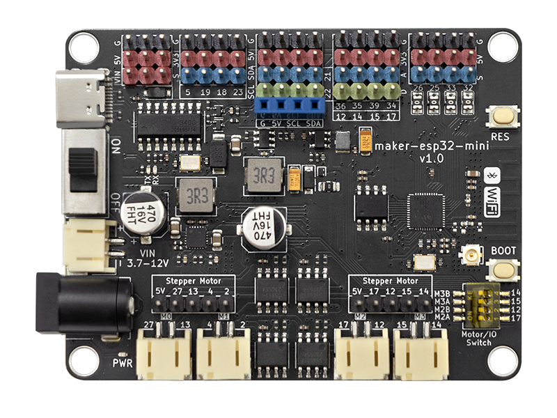
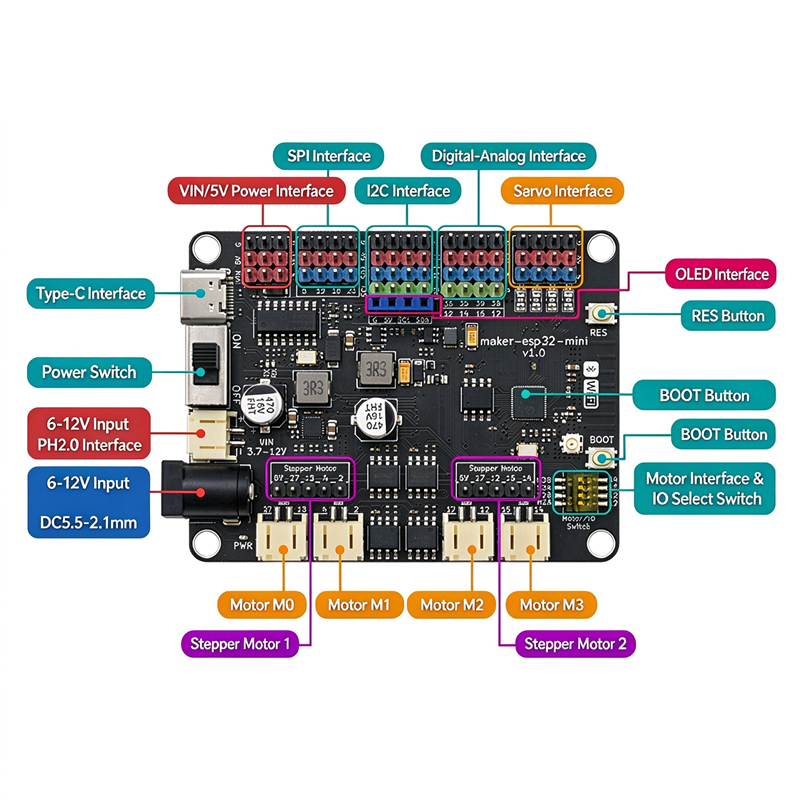
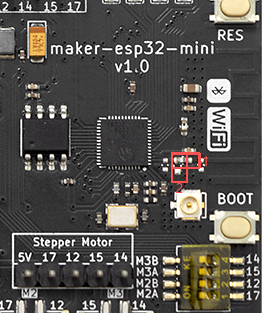
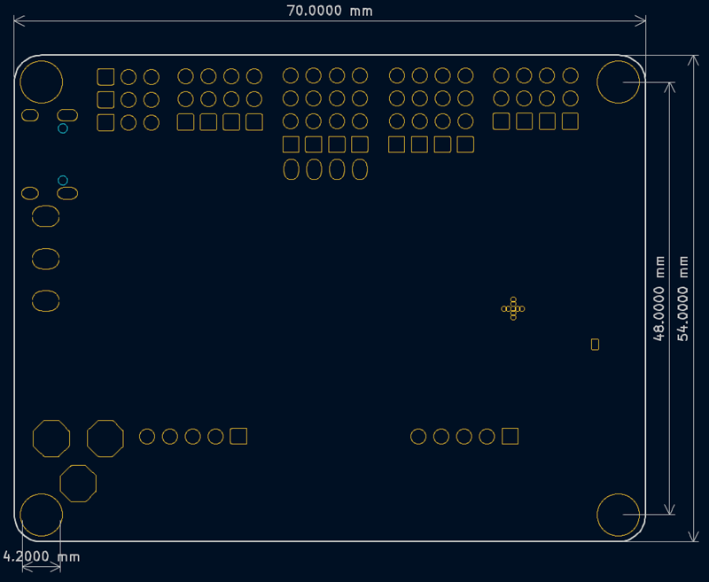
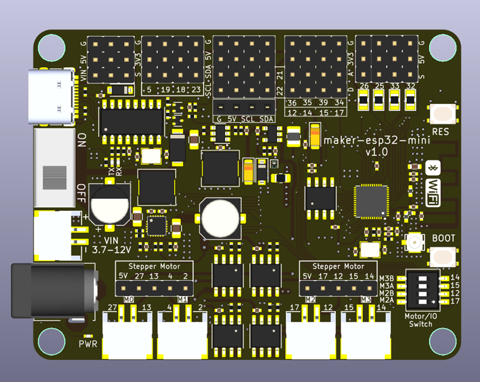

# maker-esp32-mini



A quadruple DC/stepper motor driver development board based on Espressif ESP32-DOWD-V3, designed for maker education.


## 📖 Table of Contents

- [Introduction](#-introduction)
- [Features](#-features)
- [Specifications](#-specifications)
- [Pinout](#-pinout)
- [Hardware Connection](#-hardware-connection)
  - [DC Motor Ports](#dc-motor-ports)
  - [Stepper Motor Ports](#stepper-motor-ports)
  - [Servo Ports](#servo-ports)
  - [Power Inputs](#power-inputs)
- [Getting Started](#-getting-started)
  - [Driver Installation](#1-driver-installation)
  - [Arduino IDE Setup](#2-arduino-ide-setup)
  - [Uploading Programs](#3-uploading-programs)
- [Example Programs](#-example-programs)
  - [DC Motor Control](#dc-motor-control)
  - [Stepper Motor Control (28BYJ-48)](#stepper-motor-control-28byj-48)
  - [Stepper Motor Control (42 Stepper)](#stepper-motor-control-42-stepper)
  - [Servo Control](#servo-control)
  - [OLED Display](#oled-display)
- [Library Installation](#-library-installation)
- [Antenna Switching](#-antenna-switching)
- [Mechanical Dimensions](#-mechanical-dimensions)
- [FAQ](#-faq)
- [References](#-references)
- [License](#-license)

## 🔍 Introduction

**Maker-ESP32-Mini** is a maker education development board based on the Espressif **ESP32-DOWD-V3** chip. It features 4MB onboard Flash and integrates 2.4 GHz Wi-Fi and Bluetooth dual-mode connectivity. The board includes a quad DC motor driver chip with both PH2.0 horizontal SMD connectors and 2.54mm standard pin headers for motor outputs, capable of directly driving TT DC motors, LEGO motors, and other general-purpose motors. It also provides 4 independent servo ports with a peak current of up to 1A per channel.

Compared to the previous Maker-ESP32, this product has been comprehensively upgraded:

- IO0 (BOOT) pin is routed to a dedicated tactile switch
- Board dimensions with enclosure reduced to **56 × 72mm**, perfectly matching **7 × 9** LEGO grid spacing for direct mounting
- New PH2.0 power input connector with dedicated buck-boost power management IC
- Under light-load conditions, a single 3.7V lithium battery or standard battery pack can provide stable power

## ✨ Features

- ✅ Original Espressif **ESP32-DOWD-V3** chip
- ✅ Onboard PCB antenna and IPEX antenna connector (switchable)
- ✅ 4 DC motor ports, max continuous current **3A**
- ✅ 2 stepper motor ports (shared IO with DC motors)
- ✅ 4 servo ports, peak current **1A** per channel
- ✅ 5 I2C pin headers, 1 SPI pin header
- ✅ 3 VIN pin headers and 3 5V pin headers
- ✅ 12 IO pins broken out
- ✅ Supports Mixly, Arduino IDE, MicroPython, Mind+
- ✅ LEGO grid compatible for direct mounting

## 📊 Specifications

| Parameter                     | Specification                                    |
| ----------------------------- | ------------------------------------------------ |
| MCU                           | ESP32-DOWD-V3                                    |
| Flash                         | 4MB                                              |
| ROM                           | 448 KB                                           |
| SRAM                          | 520 KB                                           |
| RTC SRAM                      | 16 KB                                            |
| Wireless                      | Wi-Fi 2.4 GHz / Bluetooth dual-mode              |
| DC Motor Ports                | M0: 27, 13; M1: 4, 2; M2: 17, 12; M3: 15, 14     |
| Stepper Motor Ports           | Stepper1: 27, 13, 4, 2; Stepper2: 17, 12, 15, 14 |
| Motor Max Continuous Current  | 3A                                               |
| Servo Ports                   | 25, 26, 32, 33                                   |
| DC Input Voltage              | 3.7–12V (5.5-2.1mm)                              |
| 5V Max Output Current         | 3A                                               |
| Motor Port Max Output Current | 4A                                               |
| Dimensions                    | 70mm × 54mm                                      |
| PCB Thickness                 | 1.6mm                                            |
| Net Weight                    | 26g                                              |

> ⚠️ **Important**: For full-load operation, ensure the power supply current is ≥ 4A and the input voltage is ≥ 7.4V. Otherwise, the MCU may reset unexpectedly.

## 📌 Pinout



### Interface Overview

| Interface             | Description                |
| --------------------- | -------------------------- |
| Type-C                | Programming and power      |
| Power Switch          | Main power on/off          |
| 6-12V PH2.0 Input     | Lithium battery input      |
| 6-12V DC Input        | DC power input (5.5-2.1mm) |
| VIN/5V Headers        | Power output/input pins    |
| SPI Header            | SPI communication          |
| I2C Header            | I2C communication          |
| Analog/Digital Header | Digital/Analog IO breakout |
| Servo Ports           | 4-channel servo output     |
| OLED Header           | OLED display interface     |
| Motor Ports M0-M3     | DC motor outputs           |
| Stepper Ports         | Stepper1 / Stepper2        |
| Motor/IO Switch       | Motor/IO mode selection    |

### Important Notes

1. **Motor and IO Switch**: When the DIP switch is set to the IO side, M2 and M3 motor ports are disabled and function as regular GPIOs. When set to M3A/M3B/M4A/M4B, M2 and M3 function as motor ports.
2. **ESP32 Chip Characteristics**: Under the Arduino framework, pins **34, 35, 36, 39** cannot be used as outputs. When used as inputs, internal pull-up/pull-down resistors cannot be enabled.
3. **Wi-Fi Usage**: Use 2.4GHz networks only; 5GHz networks are not supported.

## 🔌 Hardware Connection

### DC Motor Ports

| Motor Port | Pins   |
| ---------- | ------ |
| M0         | 27, 13 |
| M1         | 4, 2   |
| M2         | 17, 12 |
| M3         | 15, 14 |

Compatible with TT DC motors, LEGO motors, and other general-purpose motors.

### Stepper Motor Ports

| Stepper Port | Pins           |
| ------------ | -------------- |
| Stepper1     | 27, 13, 4, 2   |
| Stepper2     | 17, 12, 15, 14 |

**28BYJ-48 Stepper Motor Wiring (Stepper1 example):**

| Wire Color | Pin      |
| ---------- | -------- |
| Orange     | A01 (27) |
| Pink       | A02 (13) |
| Blue       | A03 (4)  |
| Yellow     | A04 (2)  |
| Red        | 5V       |

**42 Stepper Motor (Bipolar, 4-wire) Wiring:**

| Motor Wire | Stepper1 Pin | Stepper2 Pin |
| ---------- | ------------ | ------------ |
| A+         | A01 (27)     | B01 (17)     |
| A-         | A02 (13)     | B02 (12)     |
| B+         | A03 (4)      | B03 (15)     |
| B-         | A04 (2)      | B04 (14)     |

### Servo Ports

| Servo Channel | Pin |
| ------------- | --- |
| Servo1        | 25  |
| Servo2        | 26  |
| Servo3        | 32  |
| Servo4        | 33  |

### Power Inputs

- **PH2.0 Connector**: 6–12V input
- **DC Jack**: 5.5-2.1mm, 6–12V input
- **VIN Headers**: 3 pins
- **5V Headers**: 3 pins

## 🚀 Getting Started

### 1. Driver Installation

Please refer to the [CH340G Driver Installation Guide](https://www.wch.cn/downloads/CH341SER_EXE.html).

### 2. Arduino IDE Setup

1. Download and install [Arduino IDE](https://www.arduino.cc/en/software)

2. Install ESP32 board support:
   
   - Open **File** → **Preferences**
   
   - Add the following URL to **Additional Boards Manager URLs**:
     
     ```
     https://raw.githubusercontent.com/espressif/arduino-esp32/gh-pages/package_esp32_index.json
     ```
   
   - Open **Tools** → **Board** → **Boards Manager**
   
   - Search for `esp32` and install

3. Select board: **Tools** → **Board** → **ESP32 Arduino** → **ESP32 Dev Module**

> 📌 **Note**: When using Arduino IDE, please update esp32 to the latest version.

### 3. Uploading Programs

For program upload instructions, please refer to the [ESP32 Upload Guide](https://docs.espressif.com/projects/arduino-esp32/en/latest/installing.html).

## 💡 Example Programs

### DC Motor Control

```cpp
// DC Motor Control Example
// M0: 27, 13; M1: 4, 2; M2: 17, 12; M3: 15, 14

#define MOTOR_M0_A 27
#define MOTOR_M0_B 13

void setup() {
  pinMode(MOTOR_M0_A, OUTPUT);
  pinMode(MOTOR_M0_B, OUTPUT);
}

void loop() {
  // Forward
  digitalWrite(MOTOR_M0_A, HIGH);
  digitalWrite(MOTOR_M0_B, LOW);
  delay(2000);

  // Reverse
  digitalWrite(MOTOR_M0_A, LOW);
  digitalWrite(MOTOR_M0_B, HIGH);
  delay(2000);

  // Stop
  digitalWrite(MOTOR_M0_A, LOW);
  digitalWrite(MOTOR_M0_B, LOW);
  delay(1000);
}
```

### Stepper Motor Control (28BYJ-48)

**Required Library**: `Bonezeqi_ULN2003_Stepper` v1.0.1

```cpp
#include <Bonezeqi_ULN2003_Stepper.h>

// Define stepper motor pins (Stepper1)
#define IN1 27
#define IN2 13
#define IN3 4
#define IN4 2

// Initialize stepper motor
Bonezeqi_ULN2003_Stepper stepper(IN1, IN2, IN3, IN4);

void setup() {
  stepper.begin();
  stepper.setSpeed(5); // Set speed
}

void loop() {
  stepper.step(100);  // Forward 100 steps
  delay(1000);
  stepper.step(-100); // Reverse 100 steps
  delay(1000);
}
```

### Stepper Motor Control (42 Stepper)

**Required Library**: `AccelStepper` v1.64

```cpp
#include <AccelStepper.h>

// Define stepper motor pins (Stepper1)
#define MOTOR_A_PLUS  27
#define MOTOR_A_MINUS 13
#define MOTOR_B_PLUS  4
#define MOTOR_B_MINUS 2

// Initialize AccelStepper (Full-step mode)
AccelStepper stepper(AccelStepper::FULL4WIRE, MOTOR_A_PLUS, MOTOR_A_MINUS, MOTOR_B_PLUS, MOTOR_B_MINUS);

void setup() {
  stepper.setMaxSpeed(1000);    // Max speed
  stepper.setAcceleration(500); // Acceleration
}

void loop() {
  stepper.moveTo(200);   // Move to position 200
  stepper.runToPosition();
  delay(1000);

  stepper.moveTo(0);     // Return to position 0
  stepper.runToPosition();
  delay(1000);
}
```

### Servo Control

```cpp
#include <ESP32Servo.h>

Servo servo1;
Servo servo2;

void setup() {
  servo1.attach(25); // Servo 1 on pin 25
  servo2.attach(26); // Servo 2 on pin 26
}

void loop() {
  // Servo 1: 0° to 180°
  for (int angle = 0; angle <= 180; angle++) {
    servo1.write(angle);
    delay(15);
  }
  // Servo 1: 180° to 0°
  for (int angle = 180; angle >= 0; angle--) {
    servo1.write(angle);
    delay(15);
  }
}
```

### OLED Display

```cpp
#include <Wire.h>
#include <Adafruit_GFX.h>
#include <Adafruit_SSD1306.h>

#define SCREEN_WIDTH 128
#define SCREEN_HEIGHT 64
#define OLED_RESET    -1

Adafruit_SSD1306 display(SCREEN_WIDTH, SCREEN_HEIGHT, &Wire, OLED_RESET);

void setup() {
  Wire.begin(21, 22); // SDA, SCL
  if (!display.begin(SSD1306_SWITCHCAPVCC, 0x3C)) {
    Serial.println(F("SSD1306 allocation failed"));
    for (;;);
  }
  display.clearDisplay();
  display.setTextSize(1);
  display.setTextColor(SSD1306_WHITE);
  display.setCursor(0, 0);
  display.println("Maker-ESP32-Mini");
  display.display();
}

void loop() {
  // Update display content
}
```

## 📦 Library Installation

### Installing the ULN2003 Library

1. Open Arduino IDE Library Manager:
   - Menu: **Tools** → **Manage Libraries...**
   - Shortcut: `Ctrl+Shift+I` (Windows/Linux) or `Cmd+Shift+I` (Mac)
2. Search for: `ULN2003`
3. Find the `Bonezeqi_ULN2003_Stepper` library
4. Select version `1.0.1`
5. Click **Install**

### Installing the AccelStepper Library

1. Open Arduino IDE Library Manager
2. Search for `AccelStepper`
3. Select version `1.64`
4. Click **Install**

### Installing the ESP32Servo Library

1. Open Arduino IDE Library Manager
2. Search for `ESP32Servo`
3. Click **Install**

## 📡 Antenna Switching



As shown in the figure, when the inductor is placed toward direction **1**, the onboard PCB antenna is active. When placed toward direction **2**, the IPEX antenna connector is active.

## 📐 Mechanical Dimensions



## 3D



- Overall dimensions: **70.000 mm × 54.000 mm**
- Mounting hole spacing: **48.000 mm × 4.200 mm**
- PCB thickness: **1.6 mm**

## ❓ FAQ

### Q: Mixly program upload fails?

**A:**

1. Ensure the Mixly installation path does not contain Chinese characters, spaces, or special characters. Place it in the root directory with a shallow folder hierarchy, e.g., `D:\mixly2.0-win32-x64`.
2. Check that the correct serial port is selected. If no port appears, install the CH340G driver first. Make sure the port is not occupied by another application.
3. Check the program for errors.

### Q: The motor program uploaded successfully but the motor does not rotate?

**A:**

1. The motor requires DC power (3.7–12V). We recommend using two 3.7V lithium batteries. Make sure the power switch is turned ON.
2. If step 1 is complete and the issue persists, check that the **Motor and IO Switch** is set to the motor side (marked ON).
3. Verify that the motor pins defined in the program match the actual motor pins.

### Q: Wi-Fi cannot connect?

**A:** Use a 2.4GHz network only. ESP32 does not support 5GHz networks.

### Q: The MCU resets unexpectedly?

**A:** For full-load operation, ensure the power supply current is ≥ 4A and the input voltage is ≥ 7.4V.

## 🔗 References

- [ESP32 Datasheet](https://www.espressif.com/sites/default/files/documentation/esp32_datasheet_en.pdf)
- [Getting Started - ESP32 - ESP-IDF Programming Guide](https://docs.espressif.com/projects/esp-idf/en/latest/esp32/get-started/index.html)
- [ESP-IDF Extension for VS Code](https://marketplace.visualstudio.com/items?itemName=espressif.esp-idf-extension)
- [CH340G Driver Download](https://www.wch.cn/downloads/CH341SER_EXE.html)
- [Arduino ESP32 Official Documentation](https://docs.espressif.com/projects/arduino-esp32/en/latest/)

## 📄 License

This project is licensed under the **MIT License**. See the [LICENSE](LICENSE) file for details.

## 🤝 Contributing

Issues and Pull Requests are welcome!

1. Fork this repository
2. Create your feature branch (`git checkout -b feature/AmazingFeature`)
3. Commit your changes (`git commit -m 'Add some AmazingFeature'`)
4. Push to the branch (`git push origin feature/AmazingFeature`)
5. Open a Pull Request

## 📞 Contact

- Technical Support: [support@null-lab.com.](support@null-lab.com)
- Whatsapp: +86 188 9844 2841

> **Maker-ESP32-Mini** — Making Maker Education Simpler! 🚀
